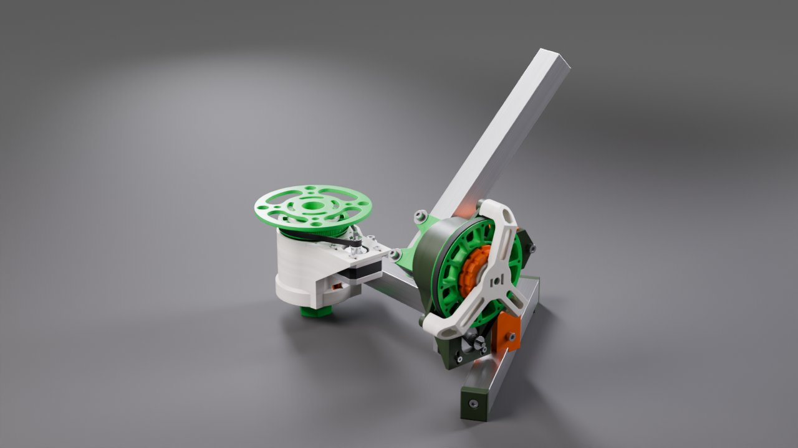
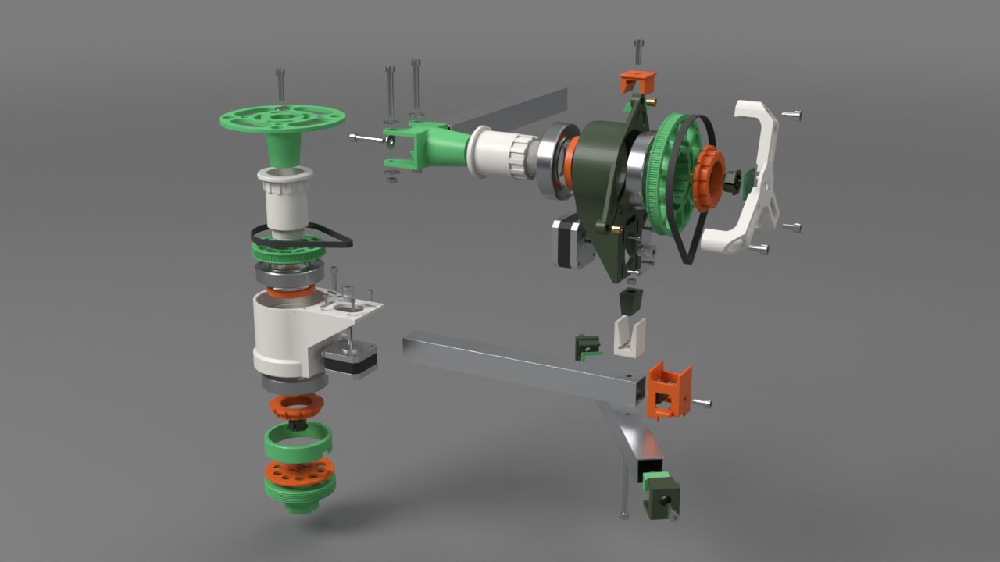
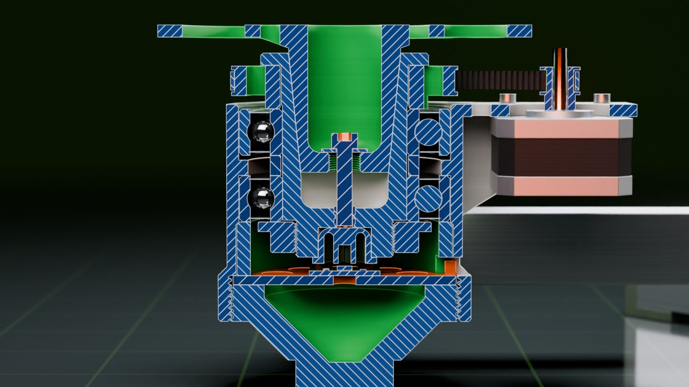
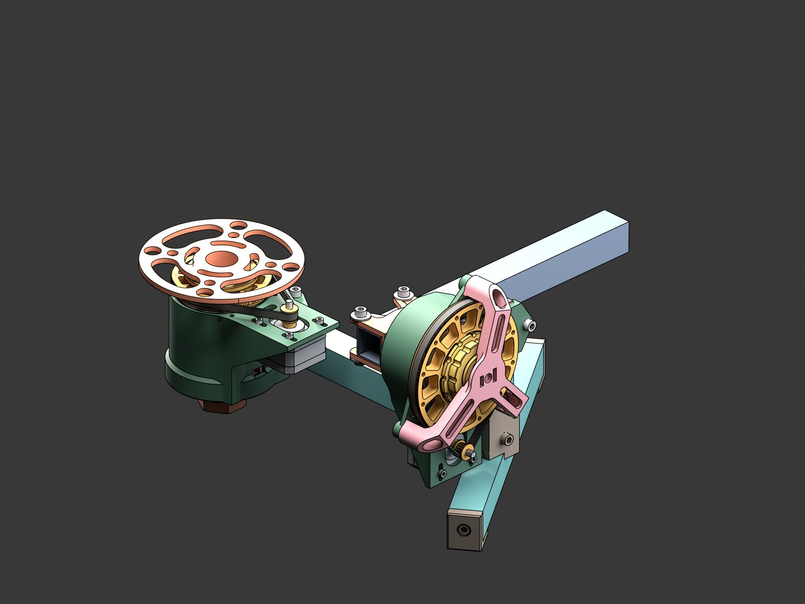
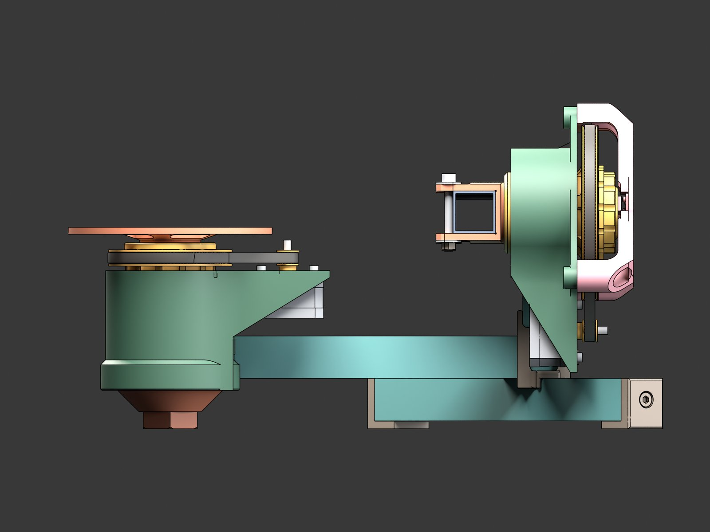
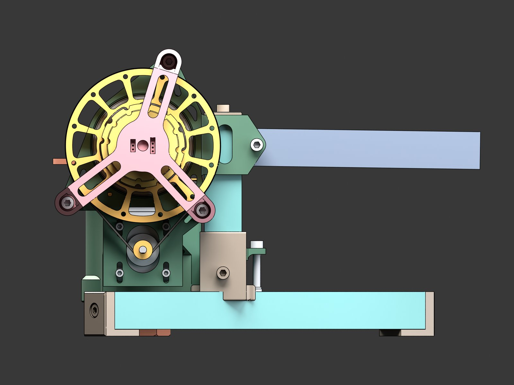
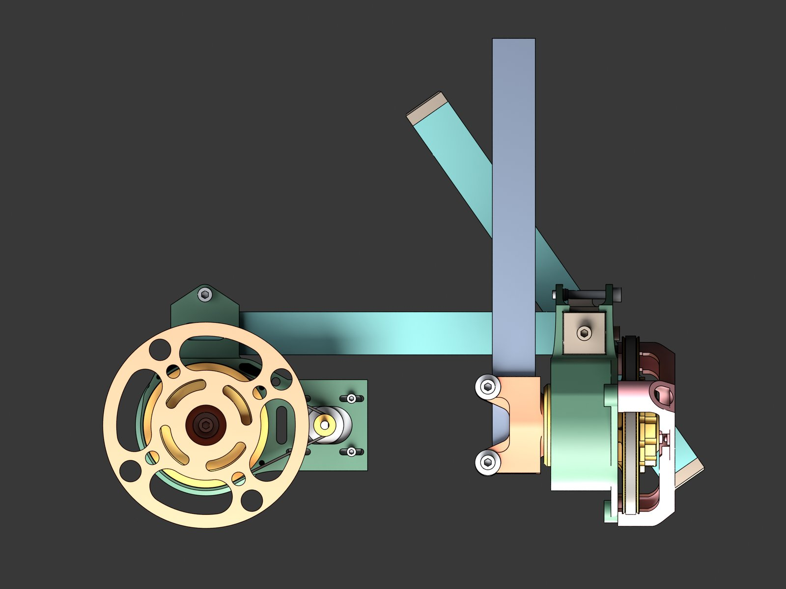

# CAD v2: second-generation mechanics

The second-generation Orbiter mechanics as open files: STL for the slicer,
STEP for exact geometry, and FreeCAD files for the parts and the whole
machine. Everything here was exported from one Fusion document, `Orbiter`
version 225 (2026-10-05).



> **Status: design files only.** The rest of this repository still describes
> and drives the [v1 rig](../README.md). See [What v2 does not have yet](#what-v2-does-not-have-yet)
> before you print anything.

## What changed from v1

| | v1 ([`cad/`](../)) | v2 (this folder) |
|---|---|---|
| Frame | printed frames | 25 × 25 mm aluminium tube: three 253 mm rails and a 93 mm vertical bar, joined by printed caps, wedges and clamp jaws |
| Axes | 5 mm steel shaft in one 608ZZ per axis | printed spindle and shaft in two 6008 ball bearings (40 × 68 × 15 mm) per axis, clamped by a printed M32×1 nut |
| Platform and arm mounts | inserts | 1:5 taper inserts, pulled out with a printed M10×0.75 extractor |
| Reduction | GT2 belt, 10T → 100T (1:10) | GT2 belt, 16T motor pulleys: 112T on azimuth (7:1), 160T on elevation (10:1) |
| Encoders | AS5600 (AZ) + AS5048A (EL) | AS5600 on both axes; the magnet sits in a `HexPlug` in the end of the spindle and of the shaft |





## Files

| Path | Contents |
|---|---|
| [`stl/printed/<colour>/`](stl/printed) | 25 printed parts, STL in mm, mesh tolerance 0.005 mm, ready for a slicer |
| [`step/printed/<colour>/`](step/printed) | the same 25 parts as STEP, exact B-rep geometry from Fusion |
| [`stl/purchased/<category>/`](stl/purchased) | 28 bought parts as STL: tube, bearings, belts, motors, motor pulleys, fasteners, heat-set inserts, AS5600 modules |
| [`freecad/Orbiter_assembly.FCStd`](freecad) | the whole machine in FreeCAD 1.0: the Fusion assembly tree, 98 occurrences, filament colours |
| [`freecad/parts/`](freecad/parts) | every part as its own `.FCStd` (53 files) |
| [`freecad/build_report.json`](freecad/build_report.json) | per-part check of the FreeCAD files against Fusion: volume, validity, closed shells |
| [`parts.csv`](parts.csv) | every component: category, colour, quantity, material, volume, role, file paths |
| [`printed_parts.csv`](printed_parts.csv) | printed parts with filament, quantity, solid mass, size, threads, bed fit, role |
| [`printed_parts.json`](printed_parts.json) | the detailed printed-parts manifest: threads, bearing seats, tapers, face mates, instances, loads. Its `files.stl` / `files.step` paths are relative to `stl/printed/` and `step/printed/` |

The colour folder is the filament spool the part is printed from:
`dark_green`, `light_green`, `red`, `pink`. The same colours are on the
bodies in Fusion and in FreeCAD.

## Previews



| Front | Side | Top |
|-------|------|-----|
|  |  |  |

Per-part renders are in [`screenshots/`](screenshots/) (`part_*.jpg`, one
per printed STL), in the same style and palette as the v1 previews so the
two sets read together. The colours there are the palette of the renders,
not the filament colours.

[`render_screenshots.py`](render_screenshots.py) makes them, headless, from
an assembly `.blend` of the v2 rig and the STL files here:

```bash
blender -b assembly.blend -P render_screenshots.py -- screenshots-png
```

It writes 2560 × 1920 PNGs; the JPEGs in `screenshots/` are those scaled
to 1600 × 1200. The assembly `.blend` is built by the Blender project in
the private hardware tree from the Fusion export and is not in this
repository; the per-part renders need only the STLs.

## Printed parts

32 pieces from 25 files, about 830 g of filament at 100 % infill (a real
print is lighter). Three of them are tools, not machine parts.

| Part | Colour | Qty | Thread | Mass each, g | Role |
|---|---|---|---|---|---|
| [`AngleSensorMount Ribbed`](stl/printed/pink/AngleSensorMount%20Ribbed.stl) | pink | 1 |  | 25 | three-legged AS5600 sensor mount on the elevation housing |
| [`BarMountInsert`](stl/printed/light_green/BarMountInsert.stl) | light_green | 1 | M10×0.75 | 48 | elevation insert: 1:5 taper into the shaft, clamp for the 25×25 orbit arm, M10×0.75 for the extractor |
| [`BaseExtractor M10x0.75`](stl/printed/red/BaseExtractor%20M10x0.75.stl) | red | 2 | M10×0.75 | 2 | **tool**: taper extractor, M10×0.75 plug with a hex socket |
| [`BaseFootPlug M75x2`](stl/printed/light_green/BaseFootPlug%20M75x2.stl) | light_green | 1 | M75×2 | 70 | foot plug of the base housing, external M75×2, hexagon for a 32 mm socket |
| [`BaseOuterRingSpacer`](stl/printed/light_green/BaseOuterRingSpacer.stl) | light_green | 1 |  | 19 | spacer between the bearing outer rings inside the base housing |
| [`BasePlatformInsert Taper`](stl/printed/light_green/BasePlatformInsert%20Taper.stl) | light_green | 1 | M10×0.75 | 56 | base insert: 1:5 taper into the spindle, 120 mm platform disc, M10×0.75 for the extractor |
| [`BasePulley GT2 112T`](stl/printed/light_green/BasePulley%20GT2%20112T.stl) | light_green | 1 |  | 25 | azimuth GT2 112-tooth pulley on the spindle splines |
| [`BaseSensorRing`](stl/printed/red/BaseSensorRing.stl) | red | 1 |  | 12 | disc holding the azimuth AS5600 under the spindle |
| [`BaseSpindle`](stl/printed/pink/BaseSpindle.stl) | pink | 1 | M32×1 | 53 | azimuth spindle: collar, splines for the pulley, M32×1, taper socket on top |
| [`BearingSpacer`](stl/printed/red/BearingSpacer.stl) | red | 2 |  | 4 | spacer between the bearing inner rings |
| [`BottomHousin`](stl/printed/dark_green/BottomHousin.stl) | dark_green | 1 |  | 114 | elevation drive housing on the vertical bar: bearing seats, motor mount |
| [`BottomHousin(Mirror)`](stl/printed/pink/BottomHousin%28Mirror%29.stl) | pink | 1 | M75×2 | 149 | azimuth drive housing on the main rail, mirrored sibling of the elevation housing, internal M75×2 at the bottom |
| [`ClampNut M32x1`](stl/printed/red/ClampNut%20M32x1.stl) | red | 2 | M32×1 | 14 | nut that clamps the bearing stack on the shaft and on the spindle |
| [`ClampNut Wrench AF32`](stl/printed/pink/ClampNut%20Wrench%20AF32.stl) | pink | 1 |  | 34 | **tool**: wrench for the clamp nut |
| [`CrossRail foot cap`](stl/printed/dark_green/CrossRail%20foot%20cap.stl) | dark_green | 2 |  | 14 | foot cap on each end of the cross rail |
| [`CrossRail load spreader`](stl/printed/pink/CrossRail%20load%20spreader.stl) | pink | 1 |  | 14 | load spreader under the head of the main stack bolt, inside the cross rail |
| [`ElevationShaft`](stl/printed/pink/ElevationShaft.stl) | pink | 1 | M32×1 | 53 | elevation shaft: splines for the pulley, M32×1 for the clamp nut, 1:5 taper socket for the insert |
| [`HexPlug`](stl/printed/dark_green/HexPlug.stl) | dark_green | 2 |  | 2 | plug holding the AS5600 magnet in the end of the shaft and of the spindle |
| [`MainRail tie cap`](stl/printed/red/MainRail%20tie%20cap.stl) | red | 1 |  | 15 | H-shaped cap tying the main rail to the cross rail |
| [`MainRail tie wedge`](stl/printed/dark_green/MainRail%20tie%20wedge.stl) | dark_green | 1 |  | 1 | nut wedge inside the tie cap |
| [`Rail cap wedge`](stl/printed/light_green/Rail%20cap%20wedge.stl) | light_green | 3 |  | 2 | M5 nut wedge inside the rail caps |
| [`ReplacablePulley`](stl/printed/light_green/ReplacablePulley.stl) | light_green | 1 |  | 43 | elevation GT2 160-tooth pulley on the shaft splines |
| [`Stack clamp jaws`](stl/printed/pink/Stack%20clamp%20jaws.stl) | pink | 1 |  | 10 | jaws clamping the vertical bar to the rails (main M5×70 bolt) |
| [`Stack clamp wedge`](stl/printed/dark_green/Stack%20clamp%20wedge.stl) | dark_green | 1 |  | 6 | nut wedge of the main stack bolt |
| [`VertivalBar top cap`](stl/printed/red/VertivalBar%20top%20cap.stl) | red | 1 |  | 6 | top cap of the vertical bar |

File names are the Fusion component names, typos included, so that they
match the manifests.

## Bought parts

The full list with quantities is [`parts.csv`](parts.csv) (rows without a
colour). In short:

- 25 × 25 mm aluminium square tube: 3 × 253 mm, 1 × 93 mm.
- 4 ball bearings 6008 (40 × 68 × 15 mm), two per axis.
- 2 × NEMA 17 motors, 24 mm body, with GT2 16-tooth pulleys.
- GT2 belts: 280 mm on azimuth, one on elevation.
- 2 × AS5600 modules. The magnets are not in the model; each sits in a
  `HexPlug`.
- M5 socket-head screws (10 to 70 mm), M5 nuts, thin nut and washers,
  M3 × 8 screws, 7 M5 × 7 heat-set inserts.

## Working with the models

**Coordinates.** A single-part file (STL, STEP, or a `.FCStd` from
`freecad/parts/`) is in the component's own frame as modelled in Fusion,
which is not always "up along Y" and is not the print orientation; pick
that in the slicer.
`Orbiter_assembly.FCStd` is in mm, Z up, the machine standing on z = 0 and
centred in X and Y. Overall size 349.9 × 285.2 × 191.8 mm.

**Printed parts in FreeCAD** are solids from the STEP files, so they can be
measured, cut and used in boolean operations. One exception:
`ReplacablePulley` is reported invalid after import, because the outline of
its 320 flat tooth faces self-intersects at tolerance level. Its volume and
shape are right and the STL prints fine, but booleans with it may fail in
FreeCAD.

**Bought parts in FreeCAD** came out of Fusion as meshes only, so they are
solids stitched from triangles. Volumes match Fusion within 0.4 %, the
solids are closed and valid, and the bearing balls are real spheres. Good
enough for layout and reference; take the manufacturer's models for drawings
of bought parts.

**The assembly** has a root `Orbiter` with one `App::Part` per Fusion
sub-assembly and an `App::Link` per occurrence, pointing into a hidden
`Components` group. The tools (`BaseExtractor`, `ClampNut Wrench AF32`) are
in the assembly but hidden, as in Fusion.

The FreeCAD files are generated from the Fusion export; the generator and
its inputs are not part of this repository. Edit the STEP or FreeCAD files
directly if you want to change a part.

## What v2 does not have yet

- **The software still models v1.** The server's 3D scene and its pivot
  and arm geometry are read from [`../assembly/Orbiter.glb`](../assembly),
  by v1 node names (`BasePulley:2`, `OrbitArm:1`, …). v2 has no GLB with
  matching names yet, so the viewer shows v1 and the server's default
  geometry is v1's.
- **The firmware reads elevation from an AS5048A over SPI.** v2 mounts an
  AS5600 on elevation, which the firmware does not drive yet.
- **No assembly guide.** The main [README](../../README.md) bill of
  materials, wiring and assembly sections describe v1. The section view
  above and the FreeCAD assembly are the best reference for now.
- **No print profile.** Orientation, infill and supports per part are not
  written down yet.

## License

[CERN-OHL-S-2.0](../LICENSE), like the rest of `cad/`.
