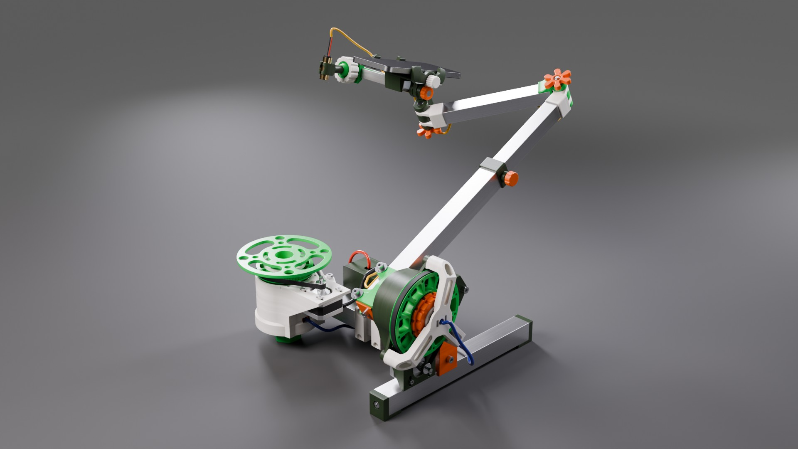
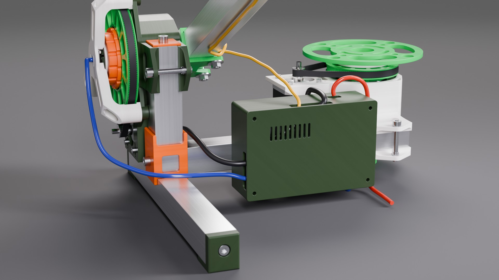
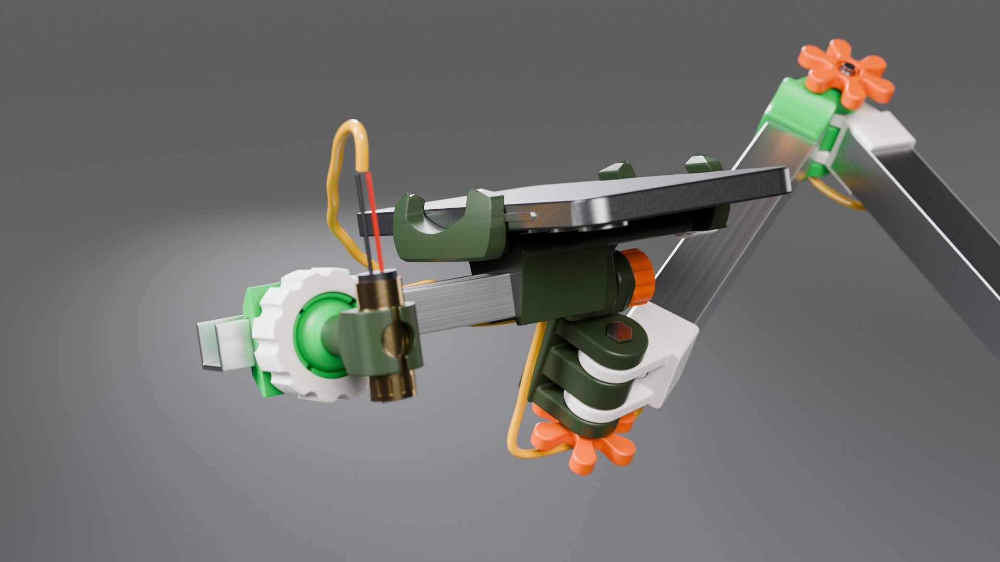
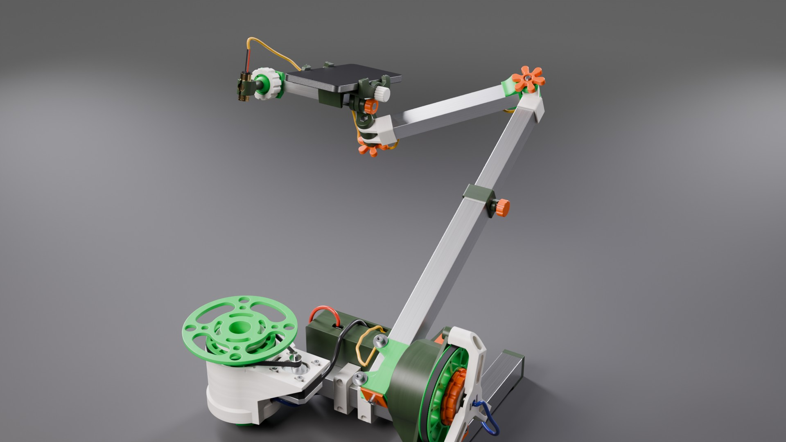
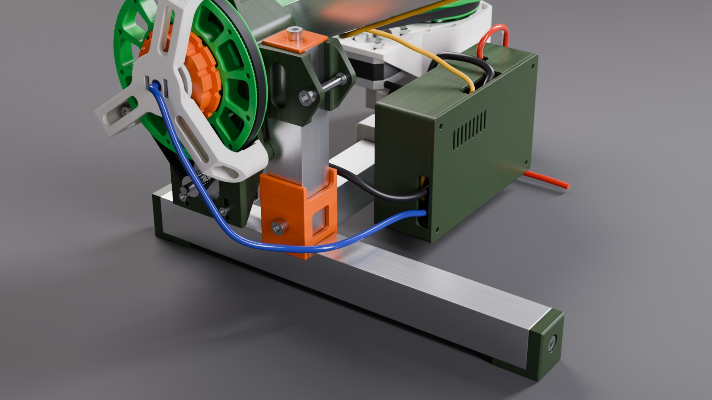

# CAD v3: the third-generation mechanics (alpha)

The Orbiter mechanics of release v0.5 as open files: STL for the slicer, STEP for exact geometry, a FreeCAD assembly
with working joints, the GLB the 3D viewers read, and renders. Everything here was exported from one Fusion
document, `Orbiter` version 250 (2026-10-27).



> **Status: alpha.** This is the first more or less complete machine: frame, both drives, the arm that carries a phone
> and a line laser, and a box for the control board. Alpha testing starts with it, and the electronics and the
> software will keep changing.
>
> - **The control board is a draft.** The Factory F0.7 board in the box (`Electronics Box`) has not been built
>   or tested yet. Its 3D model shows the size, the connectors and where the cables leave; do not order it from
>   these files.
> - **The software still reads the v2 GLB** (`cad/v2/assembly/Orbiter.glb`). Its camera model is the v2 arm with
>   the camera on the tube; moving it to the v3 arm (gliding tube, swing arm, phone head) is the next step.
>   `assembly/Orbiter.glb` here has the same rig nodes, for viewing.
> - **The wiring is schematic.** The cables in the model show the routes, not lengths or connectors.

## What changed from v2

| | v2 ([`../v2/`](../v2/README.md)) | v3 (this folder) |
|---|---|---|
| Base | the cross rail under the main rail at 35° | the cross rail at 90°: a T-shaped base on three feet. The tie cap's channel follows the parameter `CrossRail_angle` (now 0) |
| Orbit arm | one 25 × 25 tube, 253 mm | a 20 × 20 **gliding tube** slides in it as a piston (printed piston cap with an expanding wedge, a seal with an M5 lock screw and a knob), about 200 mm of travel |
| Arm end | nothing: the camera position came from calibration | a 160 mm **swing arm** on two printed hinges with M5 × 45 bolts and hand knobs. In Fusion the two hinges are linked 1:1, so the phone moves parallel to itself |
| Camera | a separate camera | the **camera head**: a phone clamp with a yaw hinge and a tilt pivot, a Galaxy S24 as the camera, and a 12 × 30 line laser on a ball mount on the clamp's profile |
| Electronics | not in the model | a printed **electronics box** for the Factory F0.7 board (100 × 75 mm) on the outer side of the main rail: standoffs, cable notches, USB-C cut-outs, vents over the drivers, held by two U-shaped clamps with M5 into heat-set inserts |
| Wiring | not in the model | schematic cables: both motors, both AS5600 sensors (the azimuth one through the slot in `BaseSensorRing` and the window in the housing), USB-C PD power, and the laser cable, one piece per moving link with the joins on the hinge axes |
| Assembly tree | groups and loose bars at the root | sub-assemblies: `Frame`, `BottomBody` (azimuth drive), `ElevationDrive`, `OrbitArm`, `Camera Head`, `Electronics Box`, `Tools`; the arm is jointed to the elevation shaft |
| FreeCAD | the Fusion tree as App::Part containers | a FreeCAD 1.0 **Assembly with joints**: seven moving links, the frame grounded, revolute joints on the two drive axes and the three hinges, a slider for the gliding tube |



| Camera head | Orbit arm | Cross rail at 90° |
|---|---|---|
|  |  |  |

## Files

| Path | Contents |
|---|---|
| [`stl/printed/<colour>/`](stl/printed) | 47 printed parts, STL in mm, mesh tolerance 0.005 mm, ready for a slicer |
| [`step/printed/<colour>/`](step/printed) | the same parts as STEP, exact B-rep geometry from Fusion |
| [`stl/purchased/<category>/`](stl/purchased) | bought parts as STL: tubes, bearings, belts, motors, pulleys, fasteners, heat-set inserts, AS5600 modules, the laser, the phone dummy, cables |
| [`freecad/Orbiter_assembly.FCStd`](freecad) | the whole machine as a FreeCAD 1.0 Assembly with joints (below) |
| [`freecad/parts/`](freecad/parts) | every part as its own `.FCStd` (the control board's own parts are only in the assembly) |
| [`freecad/build_report.json`](freecad/build_report.json) | per-part check of the FreeCAD files against Fusion: volume, validity, closed shells; the links and joints of the assembly |
| [`assembly/Orbiter.glb`](assembly) | the assembly as glTF 2.0: metres, Y up, the azimuth axis on the origin, the rotor nodes `ORB_ROTOR_base` and `ORB_ROTOR_elevation`. `Orbiter.json` next to it is the export report |
| [`parts.csv`](parts.csv) | every component: category, colour, quantity, material, volume, role, file paths |
| [`printed_parts.csv`](printed_parts.csv), [`printed_parts.json`](printed_parts.json) | the printed-parts manifest: filament, quantity, mass, size, threads, faces and what they mate with, joints, interference |
| [`print_plan.json`](print_plan.json) | a print direction for every printed part, picked by slicing the candidates (PrusaSlicer): the face down, support volume, filament, time |
| [`cadquery/`](cadquery) | CadQuery sources of the parts that were modelled in code: the gliding arm (piston, seal, hinges, swing tube, clamp hinge block) and the electronics box |
| [`images/`](images) | photoreal renders (Blender, Cycles) |
| [`screenshots/`](screenshots) | technical previews in the style of v1 and v2: the assembly from four sides and every printed part |

The colour folder is the filament spool a part is printed from: `dark_green`, `light_green`, `red`, `pink`. The
same colours are on the bodies in Fusion, in FreeCAD and in the manifest. The renders use their own palette
(pink renders white, red renders orange).

## The FreeCAD assembly

`freecad/Orbiter_assembly.FCStd` opens in FreeCAD 1.0 or later in the Assembly workbench. Under the `Orbiter`
assembly every moving link is an `App::Part` holding an `App::Link` per part:

| Link | What is in it |
|---|---|
| Frame and drives | rails, caps, both drive housings, motors, bearings' outer rings and balls, the electronics box and its cables; **grounded** |
| Azimuth rotor | spindle, pulley, platform insert, inner rings, clamp nut, magnet plug |
| Elevation rotor and orbit arm | shaft, pulley, bar insert, the 25 × 25 orbit arm with its seal and lock |
| Gliding arm | the 20 × 20 tube, its piston plug and the male hinge at its end |
| Swing arm | the 160 mm tube with its two hinges, the swing hinge bolt and knob |
| Clamp hinge block | the yaw block of the phone clamp with its bolts and knobs |
| Phone clamp and laser | the clamp jaw, the phone, the profile and the laser on its ball mount |

The joints: `Base spindle` and `Elevation shaft` (revolute, the two drive axes), `Gliding arm in OrbitArm`
(slider along the arm), `Swing arm hinge`, `Phone clamp hinge` and `Phone tilt` (revolute). Drag a link in the
Assembly workbench and the rest follows. There are no joint limits yet: the arm can be driven through the floor
and the hinges through each other; the travel that is free of collisions is in the table below.

| Joint | Free range checked in Fusion |
|---|---|
| Elevation shaft | the arm reaches the floor about 17° below the horizontal on the electronics box side |
| Gliding arm | about 200 mm of travel |
| Swing arm hinge | −58° … +150° |
| Phone clamp hinge | −65° … +150° (linked 1:1 to the swing arm hinge in Fusion) |
| Phone tilt | −115° … +16° |

## Printed parts

61 pieces from 47 files, about 1.17 kg of PLA at 100 % infill (a real print is lighter).
2 of the files are tools, not machine parts. At the print profile the parts were sliced with (12 perimeters,
so almost every part prints solid) the machine is about 79 hours of printing. **new** marks the parts that
v2 did not have, **changed** a part that v2 had in another shape; the others are the v2 parts.

| Part | Colour | Qty | Thread | Mass each, g | Down | Role |
|---|---|---|---|---|---|---|
| [`AngleSensorMount Ribbed`](stl/printed/pink/AngleSensorMount%20Ribbed.stl) | pink | 1 |  | 25 | +X | three-legged AS5600 sensor mount on the elevation housing |
| [`BarMountInsert`](stl/printed/light_green/BarMountInsert.stl) | light_green | 1 | M10x0.75 | 48 | +X | elevation insert: 1:5 taper into the shaft, clamp for the 25x25 orbit arm, M10x0.75 for the extractor |
| [`BaseExtractor M10x0.75`](stl/printed/red/BaseExtractor%20M10x0.75.stl) | red | 2 | M10x0.75 | 2 | −Y | **tool**: taper extractor: M10x0.75 plug with a hex socket |
| [`BaseFootPlug M75x2`](stl/printed/light_green/BaseFootPlug%20M75x2.stl) | light_green | 1 | M75x2 | 70 | +Y | foot plug of the base housing, external M75x2, hexagon for a 32 mm socket |
| [`BaseOuterRingSpacer`](stl/printed/light_green/BaseOuterRingSpacer.stl) | light_green | 1 |  | 19 | +Y | spacer between the bearing outer rings inside the base housing |
| [`BasePlatformInsert Taper`](stl/printed/light_green/BasePlatformInsert%20Taper.stl) | light_green | 1 | M10x0.75 | 56 | +Y | base insert: 1:5 taper into the spindle, 120 mm platform disc, M10x0.75 for the extractor |
| [`BasePulley GT2 112T`](stl/printed/light_green/BasePulley%20GT2%20112T.stl) | light_green | 1 |  | 25 | +X | base GT2 112-tooth pulley on the spindle splines |
| [`BaseSensorRing`](stl/printed/red/BaseSensorRing.stl) | red | 1 |  | 12 | −Y | disc holding the base AS5600 sensor under the spindle |
| [`BaseSpindle`](stl/printed/pink/BaseSpindle.stl) | pink | 1 | M32x1 | 53 | +X | base spindle (vertical axis): collar, splines for the pulley, M32x1, taper socket on top |
| [`BearingSpacer`](stl/printed/red/BearingSpacer.stl) | red | 2 |  | 4 | +X | spacer between the bearing inner rings |
| [`BottomHousin`](stl/printed/dark_green/BottomHousin.stl) | dark_green | 1 |  | 114 | +X | elevation drive housing on the vertical bar: bearing seats, motor mount |
| [`BottomHousin(Mirror)`](stl/printed/pink/BottomHousin%28Mirror%29.stl) | pink | 1 | M75x2 | 149 | −X | base drive housing on the main rail, mirrored sibling of the elevation housing, internal M75x2 at the bottom |
| [`Clamp Hinge Block`](stl/printed/dark_green/Clamp%20Hinge%20Block.stl) **new** | dark_green | 1 |  | 23 | +Z | phone clamp hinge block: yaw on the swing arm, tilt pivot for the clamp |
| [`ClampNut M32x1`](stl/printed/red/ClampNut%20M32x1.stl) | red | 2 | M32x1 | 14 | −X | M32x1 nut that clamps the bearing stack on the shaft and on the spindle |
| [`ClampNut Wrench AF32`](stl/printed/pink/ClampNut%20Wrench%20AF32.stl) | pink | 1 |  | 34 | +X | **tool**: wrench for the clamp nut |
| [`CrossRail foot cap`](stl/printed/dark_green/CrossRail%20foot%20cap.stl) | dark_green | 2 |  | 14 | +Z | foot cap on each end of the cross rail |
| [`CrossRail load spreader`](stl/printed/pink/CrossRail%20load%20spreader.stl) | pink | 1 |  | 14 | +Y | load spreader under the head of the main stack bolt, inside the cross rail |
| [`Electronics Box Clamp Bar`](stl/printed/pink/Electronics%20Box%20Clamp%20Bar.stl) **new** | pink | 2 |  | 13 | +Z | U-shaped bracket around the main rail holding the electronics box, M5 into heat-set inserts |
| [`Electronics Box Lid`](stl/printed/dark_green/Electronics%20Box%20Lid.stl) **new** | dark_green | 1 |  | 31 | −Z | lid of the electronics box, vents over the A4988 drivers |
| [`Electronics Box Shell`](stl/printed/dark_green/Electronics%20Box%20Shell.stl) **new** | dark_green | 1 |  | 92 | +Z | box of the Factory F0.7 board on the outer side of the main rail: standoffs, cable notches, USB-C cut-outs |
| [`ElevationShaft`](stl/printed/pink/ElevationShaft.stl) | pink | 1 | M32x1 | 53 | −X | elevation shaft: splines for the pulley, M32x1 for the clamp nut, 1:5 taper socket for the insert |
| [`HexPlug`](stl/printed/dark_green/HexPlug.stl) | dark_green | 2 |  | 2 | +X | plug holding the AS5600 magnet in the end of the shaft and of the spindle |
| [`Hinge Female 20 Body`](stl/printed/light_green/Hinge%20Female%2020%20Body.stl) **new** | light_green | 1 |  | 19 | +Z | female hinge on the swing arm tube |
| [`Hinge Knob HandNutM5`](stl/printed/red/Hinge%20Knob%20HandNutM5.stl) **new** | red | 2 |  | 4 | −Y | hand knob on the M5x45 hinge bolts |
| [`Hinge Male 20 Body`](stl/printed/pink/Hinge%20Male%2020%20Body.stl) **new** | pink | 2 |  | 14 | +Z | male hinge plug for a 20x20 tube: gliding tube end and swing arm far end |
| [`Hinge Wedge`](stl/printed/dark_green/Hinge%20Wedge.stl) **new** | dark_green | 3 |  | 1 | −Z | nut wedge inside the hinge plugs |
| [`Laser Clamp`](stl/printed/dark_green/Laser%20Clamp.stl) **new** | dark_green | 1 |  | 4 | −Z | cross clamp holding the 12x30 line laser on the ball |
| [`Laser Mount Ball`](stl/printed/light_green/Laser%20Mount%20Ball.stl) **new** | light_green | 1 |  | 5 | +Z | ball of the laser ball joint |
| [`Laser Mount Clip`](stl/printed/light_green/Laser%20Mount%20Clip.stl) **new** | light_green | 1 |  | 12 | −Z | clip gripping the 16x13 profile, seat of the laser ball joint |
| [`Laser Mount Nut`](stl/printed/pink/Laser%20Mount%20Nut.stl) **new** | pink | 1 |  | 7 | −Z | nut clamping the laser ball |
| [`MainRail tie cap`](stl/printed/red/MainRail%20tie%20cap.stl) **changed** | red | 1 |  | 14 | −Y | H-shaped cap tying the main rail to the cross rail at 90 degrees, walls along the cross rail |
| [`MainRail tie wedge`](stl/printed/dark_green/MainRail%20tie%20wedge.stl) | dark_green | 1 |  | 1 | +Z | nut wedge inside the tie cap |
| [`OrbitArm Seal`](stl/printed/dark_green/OrbitArm%20Seal.stl) **new** | dark_green | 1 |  | 8 | −Z | seal in the OrbitArm open end: sleeve in the bore, 20x20 bore for the gliding tube, collar with the M5 lock boss |
| [`Phone Clamp Knurled Head`](stl/printed/pink/Phone%20Clamp%20Knurled%20Head.stl) **new** | pink | 1 |  | 3 | −Y | knurled head on the clamp screw, snapped into the lower jaw |
| [`Phone Clamp Lower`](stl/printed/dark_green/Phone%20Clamp%20Lower.stl) **new** | dark_green | 1 |  | 31 | −Y | phone clamp jaw with the channel for the 16x13 profile |
| [`Phone Clamp Screw Bottom`](stl/printed/pink/Phone%20Clamp%20Screw%20Bottom.stl) **new** | pink | 1 |  | 1 | +Z | lower half of the clamp screw (printed split at its axis, pinned to the upper half) |
| [`Phone Clamp Screw Top`](stl/printed/pink/Phone%20Clamp%20Screw%20Top.stl) **new** | pink | 1 |  | 1 | −Z | upper half of the clamp screw |
| [`Phone Clamp Upper`](stl/printed/dark_green/Phone%20Clamp%20Upper.stl) **new** | dark_green | 1 |  | 15 | −Z | phone clamp sliding jaw: dovetail bar in the lower jaw, nut thread on the clamp screw |
| [`Piston Cap`](stl/printed/pink/Piston%20Cap.stl) **new** | pink | 1 |  | 5 | +Z | piston plug on the inner end of the gliding tube: lid sliding in the OrbitArm bore, expanding insert in the 20x20 tube |
| [`Piston Wedge`](stl/printed/dark_green/Piston%20Wedge.stl) **new** | dark_green | 1 |  | 1 | +Z | wedge of the piston plug, pulled into a nut by an M5x16 |
| [`Pivot Knob`](stl/printed/red/Pivot%20Knob.stl) **new** | red | 1 |  | 2 | +Y | knob on the phone clamp tilt pivot bolt |
| [`Rail cap wedge`](stl/printed/light_green/Rail%20cap%20wedge.stl) | light_green | 4 |  | 2 | +Z | M5 nut wedge inside the rail caps |
| [`ReplacablePulley`](stl/printed/light_green/ReplacablePulley.stl) | light_green | 1 |  | 43 | +X | elevation GT2 pulley on the shaft splines |
| [`Seal Lock Knob`](stl/printed/red/Seal%20Lock%20Knob.stl) **new** | red | 1 |  | 2 | +Z | fluted knob over the M5x12 lock screw of the seal |
| [`Stack clamp jaws`](stl/printed/pink/Stack%20clamp%20jaws.stl) | pink | 1 |  | 10 | −X | jaws clamping the vertical bar to the rails (main M5x70 bolt) |
| [`Stack clamp wedge`](stl/printed/dark_green/Stack%20clamp%20wedge.stl) | dark_green | 1 |  | 6 | +Z | nut wedge of the main stack bolt |
| [`VertivalBar top cap`](stl/printed/red/VertivalBar%20top%20cap.stl) | red | 2 |  | 6 | +Z | top cap of the vertical bar |

"Down" is the axis of the part's own (STL) frame that faces the bed in the picked print direction; the details are
in [`print_plan.json`](print_plan.json). File names are the Fusion component names, typos included, so that they
match the manifests.

## Bought parts

The full list with quantities is [`parts.csv`](parts.csv) (rows without a colour). New since v2:

- 20 × 20 × 1.5 mm aluminium square tube: 253 mm (gliding tube) and 160 mm (swing arm).
- 16 × 13 mm aluminium U profile, 120 mm, for the phone clamp.
- M5 × 45 hinge bolts, M5 × 12 / 16 / 25 socket-head screws, M5 thin nuts, more M5 × 7 heat-set inserts.
- For the electronics box, not in the model yet: 4 × M5 × 35 and 4 × M5 heat-set inserts (the two clamps),
  4 × M4 × 8 and 4 × M4 heat-set inserts (the board), 4 × M3 × 8 and 4 × M3 heat-set inserts (the lid).
- A 12 × 30 mm line laser module.
- A phone as the camera (the model has a Galaxy S24 dummy).
- The Factory F0.7 control board (draft, see the status note above): ESP32 module, two A4988 drivers, USB-C PD power.

## The assembly GLB

`assembly/Orbiter.glb` is made by [`export_glb.py`](export_glb.py) from the Blender master scene of the model:
everything that turns with the platform is under `ORB_ROTOR_base`, everything that turns with the elevation shaft
(the whole arm and the camera head) under `ORB_ROTOR_elevation`, with the origins on the axes. The parts are named
after their Fusion occurrences. The export decimates meshes over 4000 faces; the report is
[`assembly/Orbiter.json`](assembly/Orbiter.json).

## Regenerating

The STL, STEP, manifests, FreeCAD files and renders are produced by the export pipeline in the private hardware tree
(the Fusion exporter, the Blender project and the FreeCAD builder). [`export_glb.py`](export_glb.py) and
[`render_screenshots.py`](render_screenshots.py) are the two steps that run on files from this folder and the
master scene:

```bash
blender -b master.blend -P export_glb.py -- assembly/Orbiter.glb
blender -b master.blend -P render_screenshots.py -- screenshots-png stl/printed
```

`render_screenshots.py` renders on the card whose name contains `ORB_GPU` (default `5060`).

## License

[CERN-OHL-S-2.0](../LICENSE), like the rest of `cad/`.
